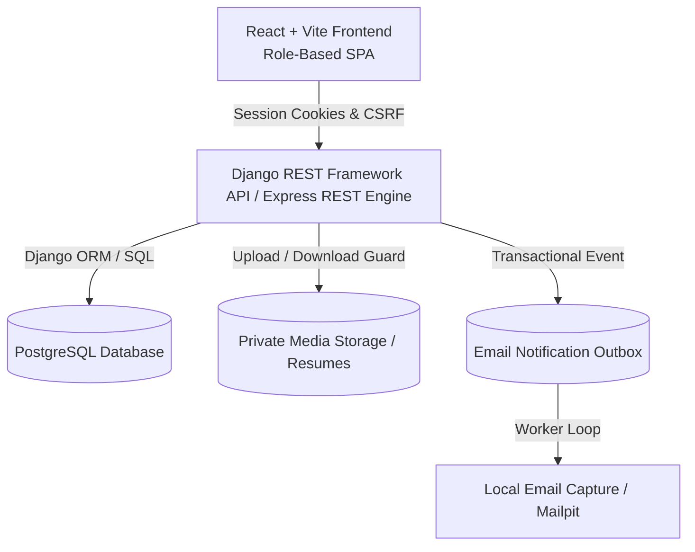
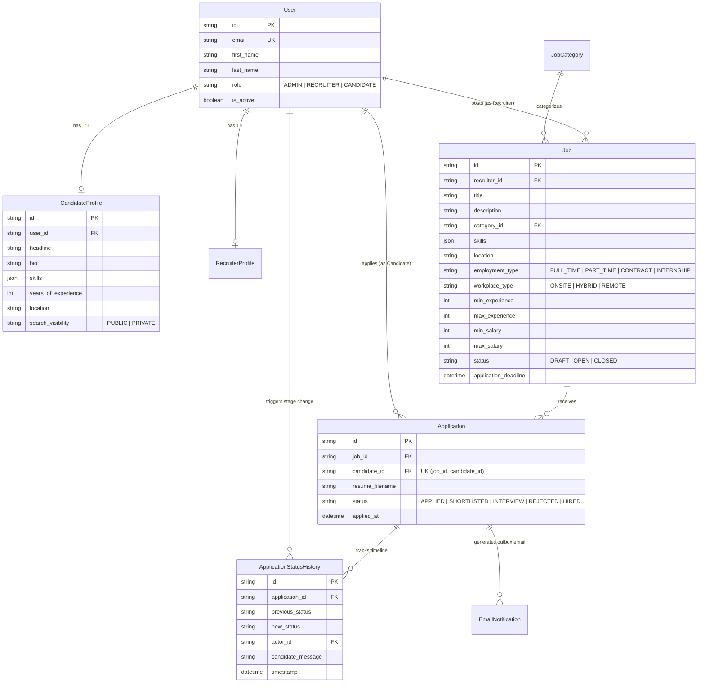

# Markytics Consulting Job Portal & Recruitment Management System

A full-stack Job Portal and Recruitment Management System built for the **Markytics Consulting Pvt Ltd Intern Onboarding Program**.

---

## 1. System Architecture



---

## 2. Entity-Relationship (ER) Diagram



---

## 3. Permission Matrix

| Resource / Endpoint | Anonymous Visitor | Candidate | Recruiter | Administrator |
| :--- | :--- | :--- | :--- | :--- |
| **Browse / Search Published OPEN Jobs** | ✅ Allowed | ✅ Allowed | ✅ Allowed | ✅ Allowed |
| **View Draft Jobs** | ❌ Denied | ❌ Denied | ✅ Owned Jobs Only | ✅ Allowed All |
| **Submit Application (with Resume PDF)** | ❌ Denied | ✅ Allowed (1 app per job) | ❌ Denied | ❌ Denied |
| **View Candidate Own Applications & History** | ❌ Denied | ✅ Own Apps Only | ❌ Denied | ✅ Allowed All |
| **View Recruiter Applicants** | ❌ Denied | ❌ Denied | ✅ Owned Jobs Only | ✅ Allowed All |
| **Change Application Stage** | ❌ Denied | ❌ Denied | ✅ Owned Jobs Only | ✅ Allowed All |
| **Download PDF Resume** | ❌ Denied | ✅ Own Resume Only | ✅ Owned Job Applicants | ✅ Allowed All |
| **Talent Directory Search** | ❌ Denied | ❌ Denied | ✅ Public Profiles & Applicants | ✅ Allowed All |
| **Admin User Governance** | ❌ Denied | ❌ Denied | ❌ Denied | ✅ Allowed |

---

## 4. Application Stage Transition Rules

Allowed workflow transitions:
- **APPLIED** &rarr; **SHORTLISTED** or **REJECTED**
- **SHORTLISTED** &rarr; **INTERVIEW** or **REJECTED**
- **INTERVIEW** &rarr; **HIRED** or **REJECTED**
- **HIRED** and **REJECTED** are terminal statuses.

Backend Enforcement Rules:
1. Candidate self-status modifications are strictly rejected (`403 Forbidden`).
2. Recruiters cannot change stages for jobs owned by other recruiters (`403 Forbidden`).
3. Repeated requests with the current status are idempotent and do not duplicate history records or email outbox notifications.
4. Each valid stage change generates an `ApplicationStatusHistory` entry and a transactional `EmailNotification` outbox record in a single database transaction.

---

## 5. Explicit Dashboard Metric Definitions

- **Jobs Posted**: Count of job records that have been published at least once (`published_at != null`), excluding drafts.
- **Successful Hires**: Count of applications currently in `HIRED` status.
- **Recruiter Dashboard Metrics**: All counts are strictly scoped to jobs owned by the authenticated recruiter (`recruiter_id == user.id`).
- **Admin Dashboard Metrics**: Platform-wide aggregates across all users, job postings, and applications.

---

## 6. Docker & Local Setup Instructions

### Prerequisites
- Docker & Docker Compose installed.

### Quick Start
```bash
# 1. Clone repository and start services
docker-compose up --build -d

# 2. Run Database Migrations
docker-compose exec backend python manage.py migrate

# 3. Seed Demo Data (Markytics jobs, candidate/recruiter accounts)
docker-compose exec backend python manage.py seed_demo_data

# 4. Access Platform
# Frontend Web App: http://localhost:3000
# Django Backend REST API: http://localhost:8000/api/v1/
# Mailpit Local Email Capture Inspector: http://localhost:8025
```

---

## 7. Demo Account Credentials (Quick Selector)

- **Candidate Demo**: `candidate@example.com`
- **Recruiter Demo**: `hr@markytics.com`
- **Admin Demo**: `admin@markytics.com`

*Or click the one-click demo buttons in the top header or sign-in page.*

---

## 8. Automated Tests & Verification

```bash
# Run backend test suite
docker-compose exec backend python manage.py test tests
```

Tests cover:
- Registration cannot self-assign `ADMIN` role.
- Role-based privilege escalation rejection.
- Recruiter cross-user job isolation.
- Unique candidate application constraint (1 app per job).
- Valid vs invalid application stage transitions.
- Private resume download security guard.

---

## 9. Production Hardening Checklist

1. **Secrets**: Set `DJANGO_SECRET_KEY` and set `DEBUG="False"` in production environment.
2. **Cookies**: Set `CSRF_COOKIE_SECURE=True` and `SESSION_COOKIE_SECURE=True` when running behind HTTPS.
3. **Malware Scanning**: In production, pass uploaded resume PDFs through an antivirus service (e.g. ClamAV) prior to storing in media volume.
4. **Rate Limiting**: Enable Django REST Framework throttling (`ScopedRateThrottle`) on sensitive login and password reset endpoints.
